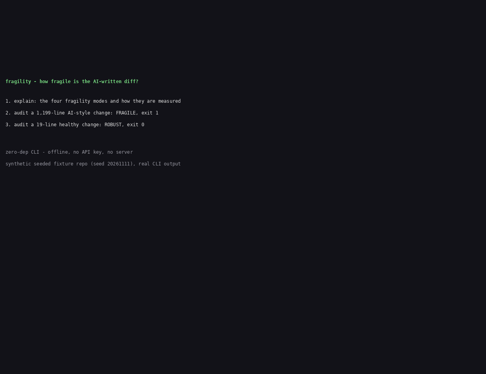

# fragility

Measure the four fragility modes of AI-written code on the diff you are about to merge - test shallowness, over-abstraction, comprehension debt, review bottleneck - in one offline command, with a CI exit gate.

AI writes code faster than humans can review it. The bottleneck moved from writing to the review gate: code that looks right, passes the easy tests, and ships before anyone understands it. fragility measures that risk with checkable numbers, not opinions. It never calls an API, never judges code with a model, never sends anything anywhere.

## Demo



The demo runs the real CLI on a synthetic seeded fixture repo (see `examples/README.md`): a 1,199-line AI-style change, then the same audit on a small healthy change. Full output: [demo/transcript.txt](demo/transcript.txt).

## Install (from source)

The npm package is not published yet. Install from source:

```sh
git clone https://github.com/techdevfun/fragility.git
cd fragility
npm install
npm run build
```

Then run it with `node dist/cli.js`, or link the binary once:

```sh
npm link   # makes `fragility` available on your PATH
```

Requires Node.js 20 or newer. Zero runtime dependencies.

## Quick start

```sh
# Audit the change on your current branch against main
fragility audit
# exit 0 = ROBUST or WATCH, 1 = FRAGILE, 2 = input error

# Audit a specific range, or a diff file (no git needed for signals 1-2)
fragility audit --base HEAD~1
fragility audit --diff examples/pr-fragile.diff

# Add changed-line coverage from an LCOV report (signal 1)
fragility audit --base HEAD~1 --coverage coverage/lcov.info

# Machine-readable output for CI
fragility audit --format json

# See how each signal is measured, with thresholds and sources
fragility explain
fragility explain tests
```

## Worked example

The fixtures in `examples/` are synthetic (seed 20261111) - a
deliberately fragile change and a small healthy one:

```sh
npm run build
node dist/cli.js audit --diff examples/pr-fragile.diff
```

```
fragility audit - diff file examples/pr-fragile.diff

Signal               Score  Verdict  Detail
------------------------------------------------------------------------
Test shallowness       10   WEAK     4 test(s), 3 assertion(s) (0.75/test); 100% weak assertions; 1 test(s) assert nothing; no edge-case tests
Over-abstraction       45   WEAK     8 changed function(s), max call depth 8, 5 flagged; worst: src/checkout.ts:70 processOrder (call depth 8 >= 4)
Comprehension debt     -   SKIPPED  no git history
Review bottleneck      85   ROBUST   113 lines changed, detection estimate 78% (100-300 lines, SmartBear curve), velocity unknown (no git history)
------------------------------------------------------------------------
FRAGILITY SCORE 47/100 - FRAGILE (skipped: comprehension - no git history)
```

```sh
node dist/cli.js audit --diff examples/pr-healthy.diff
# FRAGILITY SCORE 100/100 - ROBUST, exit 0
```

## The four signals

| Signal | What it measures | How it is scored |
| --- | --- | --- |
| **Test shallowness** | Whether the tests covering the changed lines actually check anything: assertions per test, tests that assert nothing, weak matchers (`toBeTruthy`, `toBeDefined`, `assert x is not None`), edge-case tests. With `--coverage`, LCOV branch/line coverage of the changed lines only. | Start 100. -40 under 1 assertion/test. -25 if over half the assertions are weak (-10 if any are weak). -15 if any test asserts nothing. -10 with no edge-case test. With coverage: -(1 - rate) * 30. |
| **Over-abstraction** | How deep the changed TS/JS functions delegate: call-chain depth (longest chain of calls to locally defined functions), parameter count, branch count, function length. | Thresholds: depth >= 4, params >= 5, branches >= 10, length > 80 lines. Each flagged function -15 (max -45); max depth >= 6 costs -10 more. |
| **Comprehension debt** | The share of changed lines nobody has re-touched since an AI-marked commit (git blame + commit-message markers such as "Co-Authored-By: Claude", configurable), plus how many distinct authors touched these files in the last 90 days. | -(orphan ratio * 60); -15 when exactly one author touched the files in 90 days. |
| **Review bottleneck** | Diff size mapped to the SmartBear detection curve (2,500 PRs: ~87% of defects caught under 100 lines, 78% at 100-300, 65% at 300-600, 42% at 600-1,000, 28% above 1,000), plus lines merged per day over the last 30 days vs a 400 lines/day sustainable review capacity. | Detection estimate mapped 87 -> 100, 28 -> 0. Velocity over 400 lines/day -20; over 800 -35. |

The composite **FRAGILITY SCORE** is the mean of the signals that ran
(0-100, 100 = robust). ROBUST >= 80, WATCH 60-79, FRAGILE < 60.
Signals without git history are skipped and excluded from the mean;
the report says which ones. Use `--fail-under N` to set your own gate.

## Commands

| Command | What it does |
| --- | --- |
| `fragility audit [--base <ref>] [--diff <file>] [--repo <dir>] [--coverage <lcov>] [--format table\|json] [--fail-under N] [--config <file>]` | Score the four signals on a git range or a diff file. Default base is the merge-base with main, else `HEAD~1`. |
| `fragility explain [signal]` | How a signal is measured, its thresholds, and its sources. |
| `fragility init [dir]` | Write `fragility.config.json` with the default thresholds and AI markers. Refuses to overwrite. |

## Where rivals beat us

- **patchcov** measures patch coverage more precisely (a real
  coverage-report join, five formats). fragility's static-only mode
  cannot tell you a changed line actually ran - pass `--coverage` when
  you have a report.
- **gapix** does deeper per-test AST analysis of assertion quality.
  fragility counts assertions by pattern, not by AST.
- **CodeRabbit-style reviewers** read the diff and judge it. fragility
  only measures; it cannot tell you whether a flagged abstraction is
  actually wrong.
- **LinearB** sees the whole org's review queue. fragility sees one
  diff at a time.

fragility's edge is the combination: all four fragility modes, measured
deterministically on the diff, offline, in one command, with a CI exit
code - no account, no key, no server.

## Honest limits

- Assertion counting is regex-based, not a full AST: table-driven and
  dynamic tests may be under-counted. It counts what tests assert, not
  whether the assertions are correct.
- Abstraction metrics are regex-based over TS/JS (Python abstraction
  analysis is roadmap): unusual syntax can be misread. A flagged
  function is a prompt to look, not a verdict.
- Comprehension debt reads commit messages, not authorship. A commit
  without a marker may still be AI-written, and a marker may be a
  false positive. The signal is "lines un-retouched since an AI-marked
  commit", never "lines AI wrote".
- The detection-rate curve is population data (SmartBear, 2,500 PRs),
  not a prediction for your PR. It is reported as an estimate, with the
  source named.
- The tool does not score code "quality" and does not review diffs. It
  reports whether the four fragility signals are present, where, and
  how strongly. What you do about a FRAGILE verdict is a team decision.

## Roadmap

- SARIF output so GitHub code scanning can surface findings.
- Python abstraction analysis (call depth, params, branches).
- `fragility watch` - re-audit on every commit during a review.
- Per-file JSONL history to track the score of a repo over time.

## License

MIT. See [LICENSE](LICENSE).
